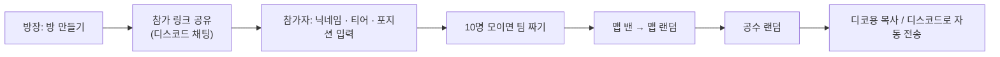

# naejeon-kit

발로란트 내전에서 **팀 짜기 · 맵 선택 · 공수 정하기**를 링크 하나로 끝내는 웹앱.

👉 https://naejeon-kit.vercel.app

- 디스코드 내전 때마다 티어를 묻고, 손으로 팀을 나누고, 맵·공수를 정하는 번거로움을 줄인다
- 방장이 방을 만들고 참가 링크를 공유하면, 참가자가 각자 닉네임·티어·포지션을 입력한다
- 10명이 모이면 버튼 한 번으로 실력이 비슷한 5:5 팀을 짜고, 맵·공수도 서버에서 랜덤으로 정한다
- 결과는 디코용 텍스트로 복사하거나 디스코드 채널로 자동 전송한다
- 회원가입 없이 쓰고, 방은 24시간 뒤 자동 삭제된다

## 사용 흐름



## 주요 기능

| 기능 | 설명 |
|---|---|
| 로그인 없는 방 | 6자리 방 코드와 참가 링크. 방은 24시간 뒤 자동 삭제 |
| 각자 입력 | 참가자가 본인 닉네임 · 현재/최고 티어 · 선호 포지션을 직접 입력하고 본인만 수정·삭제. 방장은 전체 관리 |
| 실시간 반영 | 누가 들어오고 고치면 모든 화면에 바로 반영 |
| 팀 자동 분배 | 티어 점수 합이 비슷하고 포지션 구멍이 없도록 5:5. [팀 다시 짜기]를 누르면 다음으로 좋은 조합 (상위 10개 순환) |
| 같은 팀 묶기 | 꼭 같이 해야 하는 두 명을 묶으면 팀을 짤 때 항상 같은 팀 (최대 4쌍) |
| 선수 교체 | 자동으로 짠 팀에서 두 명을 골라 맞바꾸면 점수 · 추천 포지션 다시 계산 |
| 참가자 화면 | 팀 결과, **내 팀**, 내 팀의 시작 진영(공격/수비)이 보인다 |
| 맵 | 방장이 맵 풀 설정 · 최대 2개 밴 → 서버에서 랜덤 |
| 공수 | 서버에서 팀1 시작 진영 랜덤 |
| 결과 공유 | [디코용 복사]로 텍스트 복사, 또는 디스코드 채널로 자동 전송 (방장이 연결한 경우) |

### 팀 분배 방식

1. 개인 점수 = 현재 티어 점수 × 0.6 + 최고 티어 점수 × 0.4 (아이언1 = 1 … 레디언트 = 33)
2. 10명을 5:5로 나누는 126가지 조합을 모두 비교 (같은 팀으로 묶은 두 명이 갈라지는 조합은 제외)
3. ① 포지션(타격대 · 척후대 · 전략가 · 감시자) 구멍이 없고 → ② 두 팀 점수 차가 작고 → ③ 주력 포지션을 많이 맡는 조합이 위

맵 · 공수 랜덤은 브라우저가 아니라 **서버(DB 함수)에서** 뽑는다.

## 기술 스택

| 영역 | 기술 |
|---|---|
| 프레임워크 | Next.js 16 (App Router) · React 19 · TypeScript |
| 스타일 | Tailwind CSS v4 |
| 데이터 | Supabase (Postgres · RLS · RPC · Realtime) · TanStack Query |
| 테스트 | Vitest · Testing Library · PGlite (마이그레이션·RPC 검증) |
| 배포 | Vercel |

모든 DB 쓰기는 권한을 검사하는 RPC 로만 하고, 방장 키 · 수정 토큰 · 디스코드 웹훅 같은 비밀 값은 공개되지 않는 테이블에 따로 둔다.

## 직접 실행하기

1. 의존성 설치

   ```bash
   npm install
   ```

2. Supabase 프로젝트를 만들고 `supabase/migrations/` 의 SQL 을 순서대로 적용한다 (`npx supabase link` 후 `npx supabase db push`, 또는 대시보드 SQL Editor).

3. 환경변수 설정 — `.env.example` 을 `.env.local` 로 복사하고 값을 채운다.

   | 이름 | 용도 |
   |---|---|
   | `NEXT_PUBLIC_SUPABASE_URL`, `NEXT_PUBLIC_SUPABASE_ANON_KEY` | Supabase 프로젝트 URL · anon 키 |
   | `NEXT_PUBLIC_DISCORD_ENABLED` | `true` 일 때만 디스코드 연동 표시 (선택) |
   | `DISCORD_CLIENT_ID`, `DISCORD_CLIENT_SECRET`, `DISCORD_REDIRECT_URI` | 디스코드 OAuth2 (서버 전용, 선택) |

4. 실행

   ```bash
   npm run dev
   ```

| 명령 | 설명 |
|---|---|
| `npm run dev` | 개발 서버 |
| `npm run build` | 프로덕션 빌드 |
| `npm run lint` / `npm run typecheck` | ESLint / tsc |
| `npm test` | Vitest (마이그레이션을 PGlite 에 적용해 RPC 까지 테스트) |
| `npm run format` | Prettier |
| `npm run fetch-assets` | valorant-api.com 에서 맵 · 티어 이미지 받기 |

## 폴더 구조

```
src/
  app/            페이지 · Route Handler (/api/discord/*)
  features/       room · members · teams · map · side · share · discord
  components/ui/  버튼 · 시트 · 토스트 등 공통 UI
  lib/            상수(티어 점수 · 포지션 · 맵), Supabase 클라이언트
supabase/
  migrations/     테이블 · RLS · RPC
  tests/          RPC 테스트 (PGlite)
docs/             PRD · 디자인 핸드오프 · 기술 문서
```

## 문서

- [docs/PRD.md](docs/PRD.md) — 기능 스펙
- [docs/README.md](docs/README.md) — 운영 / 개발 환경별 기술 문서
- [개인정보처리방침](https://naejeon-kit.vercel.app/privacy)

---

naejeon-kit 은 Riot Games 와 무관한 팬 제작 도구입니다. naejeon-kit isn't endorsed by Riot Games and doesn't reflect the views or opinions of Riot Games or anyone officially involved in producing or managing Riot Games properties.
