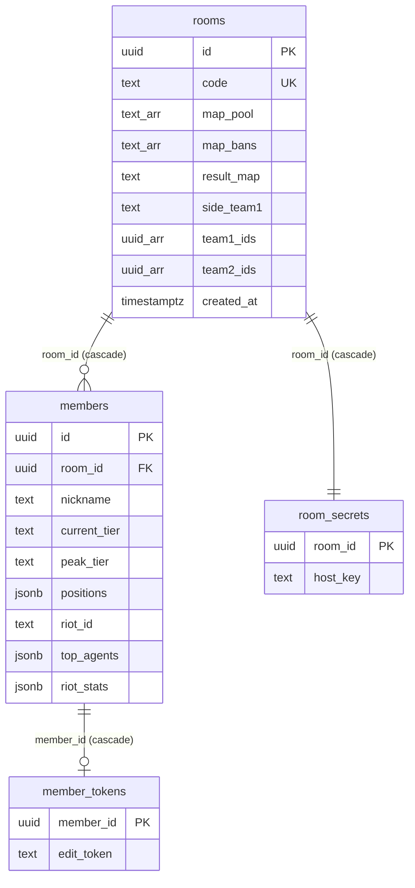

# API · 데이터 — 개발

> 환경: 개발(feature/riot-link) · 기준 커밋: `e28af42` · 작성일: 2026-10-08
> 근거: `supabase/migrations/*.sql`, `src/features/*/api.ts`, `src/features/riot/*`, `src/app/api/riot/callback/route.ts`

## 1. DB 스키마

### 공개 테이블 (anon SELECT, 직접 쓰기 불가)

**rooms**

| 컬럼 | 타입 | 제약 · 기본값 | 비고 |
|---|---|---|---|
| `id` | uuid | PK | |
| `code` | text | NOT NULL, UNIQUE | 6자리 (0/O/1/I/L 제외) |
| `map_pool` | text[] | NOT NULL, 기본 7개 맵 | |
| `map_roll_id` · `side_roll_id` | uuid | null | 랜덤마다 새 값 |
| `map_bans` | text[] | NOT NULL, `'{}'` | |
| `result_map` | text | null | |
| `side_team1` | text | `attack`/`defense` CHECK | |
| `team1_ids` · `team2_ids` | uuid[] | null | 방장이 공유한 팀 구성 |
| `created_at` | timestamptz | `now()` | 24시간 만료 기준 |

**members**

| 컬럼 | 타입 | 제약 · 기본값 | 비고 |
|---|---|---|---|
| `id` | uuid | PK | |
| `room_id` | uuid | FK → rooms cascade | |
| `nickname` | text | 1~16자, UNIQUE(room_id, nickname) | |
| `current_tier` · `peak_tier` | text | null | |
| `positions` | jsonb | 기본 4개 `can` | |
| `riot_id` | text | null | `"이름#태그"`. 라이엇 연결 시 |
| `top_agents` | jsonb | null | `[{ agent, position, games }]` 최대 3개 |
| `riot_stats` | jsonb | null | `{ matchCount, wins?, winRate, avgAcs, headshotPct, bodyshotPct, legshotPct }` |
| `created_at` · `updated_at` | timestamptz | `now()` | |

### 비공개 테이블 (RLS + 정책 없음 + `revoke all`)

| 테이블 | 컬럼 |
|---|---|
| `room_secrets` | `room_id` PK FK cascade, `host_key` text |
| `member_tokens` | `member_id` PK FK cascade, `edit_token` text |

### ERD

## 2. RPC (`POST {SUPABASE_URL}/rest/v1/rpc/{함수}`)

모두 `security definer`, `set search_path = public`. 라이엇 인자 3개는 `default null` → 인자를 안 넘긴 호출도 동작 (저장 시 연결 정보는 지워짐).

| 이름 | 권한 | 파라미터 | 반환 | 에러 | 비고 |
|---|---|---|---|---|---|
| `create_room` | 누구나 | — | `{ code, host_key }` | `ROOM_CODE_EXHAUSTED` | 24시간 지난 방 삭제 |
| `verify_host_key` | 누구나 | `p_code, p_host_key` | void | `ROOM_NOT_FOUND`, `FORBIDDEN` | |
| `register_self` | 누구나 | `p_code, p_nickname, p_current_tier, p_peak_tier, p_positions, p_riot_id?, p_top_agents?, p_riot_stats?` | `{ member_id, edit_token }` | `ROOM_NOT_FOUND`, `NICKNAME_TAKEN`, `INVALID_*`, `INVALID_RIOT` | |
| `update_self` | 본인 | `p_member_id, p_edit_token, …멤버 값, p_riot_id?, p_top_agents?, p_riot_stats?` | void | `FORBIDDEN`, `NICKNAME_TAKEN`, `INVALID_RIOT` | riot 인자 null → 연결 정보 삭제 |
| `delete_self` | 본인 | `p_member_id, p_edit_token` | void | `FORBIDDEN` | |
| `upsert_member_as_host` | 방장 | `p_code, p_host_key, p_member_id, …멤버 값, p_riot_id?, p_top_agents?, p_riot_stats?` | member_id | `FORBIDDEN`, `MEMBER_NOT_FOUND`, `NICKNAME_TAKEN`, `INVALID_RIOT` | |
| `delete_member` | 방장 | `p_code, p_host_key, p_member_id` | void | `FORBIDDEN` | |
| `bulk_add_members` | 방장 | `p_code, p_host_key, p_nicknames[]` | 건너뛴 닉네임[] | `FORBIDDEN` | 화면에서 사용 안 함 |
| `set_map_pool` | 방장 | `p_code, p_host_key, p_maps[]` | void | `INVALID_MAP_POOL` | |
| `roll_map` | 방장 | `p_code, p_host_key, p_bans[]` | `{ map, roll_id }` | `INVALID_BANS`, `NO_MAPS_LEFT` | |
| `roll_side` | 방장 | `p_code, p_host_key` | `attack`\|`defense` | `FORBIDDEN` | |
| `set_teams` | 방장 | `p_code, p_host_key, p_team1 uuid[], p_team2 uuid[]` | void | `INVALID_TEAMS` | 각 5명, 중복 없음, 이 방 멤버 |

### 라이엇 값 검증 (내부 함수, 실패 시 `INVALID_RIOT`)

| 함수 | 규칙 |
|---|---|
| `_validate_riot(riot_id, top_agents)` | `riot_id` 가 null 이면 `top_agents` 도 null. `^[^#]{1,16}#[^#]{1,5}$`, 22자 이하. `top_agents` 배열 ≤ 3, 원소는 `agent`(1~20자) · `position`(4종) · `games`(숫자) 정확히 3키 |
| `_validate_riot_stats(riot_id, stats)` (`20261010` 최종) | `riot_id` 없이 stats 불가. 필수 `matchCount`(1~30 정수), `winRate`·`headshotPct`·`bodyshotPct`·`legshotPct`(0~1), `avgAcs`(0~1000). 선택 `wins`(0~matchCount 정수). 명중 세 값 합 1(±0.01) 또는 전부 0. 그 밖의 키 거부 |

키 목록은 `src/features/riot/types.ts` 의 `RIOT_STATS_KEYS` 와 같아야 하고 `supabase/tests/rpc.test.ts` 가 비교한다.

## 3. Route Handler

| 메서드 | 경로 | 요청 | 응답 | 상태 코드 | 인증 |
|---|---|---|---|---|---|
| GET | `/api/riot/callback` | (예정: `?code&state`) | `{ error: "NOT_IMPLEMENTED", message }` | 501 | 없음 (스텁) |

예정 흐름은 §7.

## 4. 에러 코드

| 코드 | 의미 | 발생 위치 | 프론트 문구 |
|---|---|---|---|
| `ROOM_NOT_FOUND` | 방 없음 | RPC | 홈: "방을 찾을 수 없어요. 코드를 다시 확인해주세요." |
| `FORBIDDEN` | 키·토큰 불일치 | RPC | 방장: "방장 키가 맞지 않아요" / 참가자: "내 정보를 찾을 수 없어요. 다시 입력해주세요" |
| `NICKNAME_TAKEN` | 닉네임 중복 | RPC | "이미 있는 닉네임이에요…" |
| `MEMBER_NOT_FOUND` · `INVALID_NICKNAME` · `INVALID_TIER` · `INVALID_POSITIONS` · `INVALID_MAP_POOL` | 입력·대상 오류 | RPC | "저장하지 못했어요. 잠시 후 다시 시도해주세요" |
| `ROOM_CODE_EXHAUSTED` | 코드 생성 실패 | `create_room` | "방을 만들지 못했어요. 잠시 후 다시 시도해주세요." |
| `INVALID_BANS` | 밴 규칙 | `roll_map` | "밴은 맵 풀 안에서 2개까지만 고를 수 있어요" |
| `NO_MAPS_LEFT` | 남은 맵 없음 | `roll_map` | "남은 맵이 없어요" |
| `INVALID_TEAMS` | 팀 구성 오류 | `set_teams` | "참가자에게 팀을 공유하지 못했어요" |
| `INVALID_RIOT` | 라이엇 값 형식 | 멤버 RPC | ⚠️ 클라이언트 에러 코드 목록(`src/lib/supabase/rpc.ts` `KNOWN`)에 없음 → `UNKNOWN` 으로 처리 → "저장하지 못했어요…" |
| 라이엇 연결 `cancelled` / `failed` / `not_available` | provider 에러 (`RiotConnectError`) | `MemberForm` | "연결을 취소했어요. 직접 입력해주세요" / "연결에 실패했어요. 직접 입력해주세요" |

## 5. Realtime

| 채널 | 테이블 | 이벤트 | 필터 |
|---|---|---|---|
| `room:{roomId}` | `members` | INSERT, UPDATE | `room_id=eq.{roomId}` |
| | `members` | DELETE | 없음 (캐시 id 확인) |
| | `rooms` | UPDATE | `id=eq.{roomId}` |

## 6. 마이그레이션

| 파일 | 요약 | 개발 DB 적용 |
|---|---|---|
| `20261006000000_rooms_members.sql` | 테이블 4개 · RLS · 방/멤버/본인 RPC · Realtime | 적용 (2026-10-08 `supabase migration list` 로컬=원격) |
| `20261006010000_map_side_rpc.sql` | 맵 풀 · 맵/공수 랜덤 | 적용 (같은 근거) |
| `20261007000000_riot_link.sql` | `members.riot_id`, `top_agents` + `_validate_riot`, 멤버 RPC 재생성 | 적용 (같은 근거) |
| `20261008000000_riot_stats.sql` | `riot_stats`(if not exists) + `_validate_riot_stats`(6키), 옛 시그니처 drop 후 재생성, `notify pgrst` | 적용 (같은 근거) |
| `20261009000000_riot_stats_wins.sql` | `wins` 추가, 7키 검증 | 적용 (같은 근거) |
| `20261010000000_riot_stats_wins_optional.sql` | `wins` 선택값 (개발 DB 에 직접 반영한 내용과 동일하다고 파일에 명시) | 적용 (같은 근거) |
| `20261011000000_publish_teams.sql` | `rooms.team1_ids/team2_ids`, `set_teams` | 적용 (같은 근거) |

## 7. 외부 API

| 대상 | 엔드포인트 | 용도 | 상태 |
|---|---|---|---|
| valorant-api.com | `GET /v1/maps?language=ko-KR` | 맵 이미지 → `public/maps/` | `scripts/fetch-assets.mts` (수동) |
| valorant-api.com | `GET /v1/competitivetiers?language=ko-KR` | 최신 시즌 티어 아이콘 → `public/tiers/` | 같음 |
| valorant-api.com | `GET /v1/agents?isPlayableCharacter=true&language=en-US` + `ko-KR` | 요원 아이콘 → `public/agents/`, 요원 표(`AGENTS`, `AGENT_POSITIONS`, `AGENT_KEY_BY_UUID`) 자동 생성 | 같음 (`-- agents`) |
| Riot RSO | 인가 · 토큰 교환 | 사용자 동의 로그인 | **예정** (Production 키 승인 후) |
| Riot Account API | `account/v1/accounts/me` | puuid, `gameName#tagLine` | 예정 |
| Riot VALORANT Match API | `val/match/v1` 매치리스트 → 매치 | 최근 경쟁전 | 예정 |

### 매치 집계 (`aggregateRiotMatches`, `src/features/riot/computeStats.ts`)

| 단계 | 규칙 |
|---|---|
| 매치 집합 | `queueId === "competitive"` → (주면) `seasonId` 현재 액트 → 내 puuid 참가 판 → 최신순 → 최대 30판. 지표·요원·포지션 모두 이 집합 |
| `wins` / `winRate` | 내 `teamId` 의 `won` 판 수 / ÷ 판 수 |
| `avgAcs` | Σ score ÷ Σ roundsPlayed |
| 명중 비율 | 모든 라운드 내 damage 의 head·body·leg 합 ÷ 셋의 합 (0 이면 전부 0) |
| `topAgents` | `characterId` → `AGENT_KEY_BY_UUID` → 판수 많은 순 3개 (동률 이름순) |
| `topPositions` | 포지션 판수 많은 순 2개 (동률 타격대→척후대→전략가→감시자) |
| 표시 기준 | 5판 미만(`STATS_MIN_MATCHES`)이면 "기록 부족" |

### 폼 자동 채우기 (`applyRiotProfile`)

| 칸 | 규칙 |
|---|---|
| 닉네임 | 비어 있을 때만 Riot ID `#` 앞 (16자) |
| 현티 | Riot 현재 티어로 덮어씀 |
| 최티 | 건드리지 않음 (공식 API 로 정확히 알 수 없음) |
| 포지션 | `topPositions[0]` 주력, `[1]` 가능, 나머지 기존 값 |
