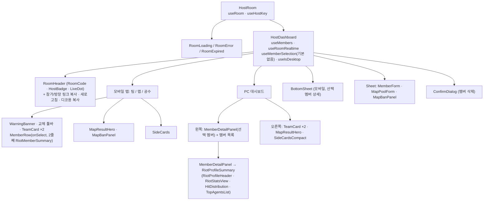
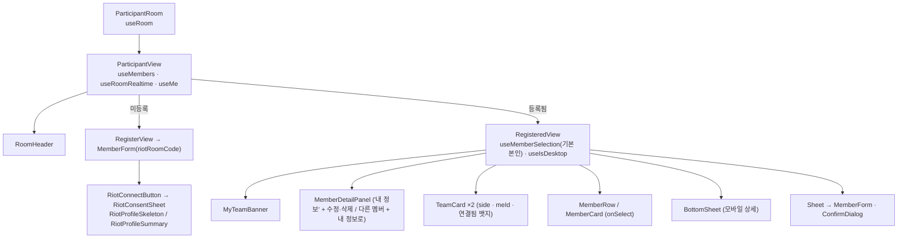

# 컴포넌트 — 개발

> 환경: 개발(feature/riot-link) · 기준 커밋: `e28af42` · 작성일: 2026-10-08

## 1. 라우트별 페이지

| 라우트 | 파일 | 렌더 | 설명 |
|---|---|---|---|
| `/` | `src/app/page.tsx` | `HomeScreen` | [방 파기] / 코드로 참가 |
| `/join/[code]` | `src/app/join/[code]/page.tsx` | `redirect` | `/room/{CODE}` 로 이동 |
| `/room/[code]` | `src/app/room/[code]/page.tsx` | `ParticipantRoom` | 참가자 화면. `?member=<id>` 로 상세 선택 |
| `/room/[code]/host` | `src/app/room/[code]/host/page.tsx` | `HostRoom` | 방장 화면. 키 없으면 참가자 화면으로. `?member=<id>` |
| `/privacy` | `src/app/privacy/page.tsx` | `PrivacyPage` | 개인정보처리방침 |
| `/api/riot/callback` | `src/app/api/riot/callback/route.ts` | Route Handler | RSO 콜백 자리 — 지금은 501 |
| 공통 | `src/app/layout.tsx`, `src/app/providers.tsx` | `RootLayout`, `Providers` | 푸터, QueryClient |

```
src/app
├─ layout.tsx ─ providers.tsx
├─ page.tsx ─ HomeScreen
├─ join/[code]/page.tsx (redirect)
├─ room/[code]/page.tsx ─ ParticipantRoom
├─ room/[code]/host/page.tsx ─ HostRoom
├─ privacy/page.tsx
└─ api/riot/callback/route.ts (501)
```

## 2. 컴포넌트 계층

### 방장 화면



### 참가자 화면



## 3. 컴포넌트 표

| 이름 | 경로 | 역할 | 주요 props | 사용 훅·쿼리 |
|---|---|---|---|---|
| `HomeScreen` | `src/features/room/HomeScreen.tsx` | 방 만들기 · 참가 | — | `createRoom`, `fetchRoom` |
| `HostRoom` / `HostDashboard` | `src/features/room/HostRoom.tsx` | 방장 화면 전체 | `code` / `room`, `host` | `useRoom`, `useHostKey`, `useMembers`, `useRoomRealtime`, `useMemberSelection`, `useIsDesktop` |
| `ParticipantRoom` / `RegisteredView` | `src/features/room/ParticipantRoom.tsx` | 참가자 화면 · 등록 후 화면 | `code` / `room`, `members`, `me`, `myMember`, `onLostMe`, `onError`, `onChanged` | `useMe`, `useMemberSelection`, `useIsDesktop` |
| `RoomHeader` / `RoomCode` | `src/features/room/RoomHeader.tsx` | 헤더 · 코드 클릭 복사 | `code`, `userType`, `connected`, `actions` | `useCopy` |
| `MemberDetailPanel` | `src/features/members/MemberDetailPanel.tsx` | 멤버 헤더 + 라이엇 카드 전체. PC 패널·모바일 시트 공용 | `member`, `title`, `actions`, `onBackToMe`, `onClose`, `hideTitle`, `emptyMessage` | — |
| `MemberForm` | `src/features/members/MemberForm.tsx` | 입력 폼 + 라이엇 연결 | `initial`, `submitLabel`, `error`, `onSubmit`, `riotRoomCode?`, `onSubmitAndNext?`, `autoFocus?` | `getRiotProvider`, `applyRiotProfile` |
| `MemberRow` / `MemberCard` | `src/features/members/MemberList.tsx` | 목록 행(버튼) / PC 카드 | `member`, `isMe`, `selected`, `highlight`, `onSelect` | — |
| `RiotMemberSummary` | 같은 파일 | 행 2줄째: 승률 · ACS · 1순위 요원 (5판 미만 "기록 부족") | `member` | — |
| `RiotConnectButton` | `src/features/riot/components/RiotConnectButton.tsx` | [라이엇 계정 연결] (플래그 꺼지면 null) | `onClick`, `disabled` | `isRiotLinkEnabled` |
| `RiotConsentSheet` | `…/RiotConsentSheet.tsx` | 동의 화면 | `open`, `onAgree`, `onCancel` | — |
| `RiotProfileSummary` / `RiotProfileSkeleton` / `RiotLinkedBadge` | `…/RiotProfileSummary.tsx` | 요약 카드 / 로딩 / "연결됨" 뱃지 | `riotId`, `tier`, `peakTier`, `topAgents`, `stats`, `onDisconnect` | — |
| `RiotProfileHeader` | `…/RiotProfileHeader.tsx` | 엠블럼 · Riot ID · 현티/최티 · "이번 액트 최근 N판" | `riotId`, `tier`, `peakTier`, `matchCount` | — |
| `RiotStatsView` | `…/RiotStatsView.tsx` | 지표 타일 3개 + 명중 분포 (5판 미만 안내) | `stats` | — |
| `StatTile` / `StatTileGrid` | `…/StatTile.tsx` | 지표 타일 | `label`, `value`, `caption` | — |
| `HitDistribution` | `…/HitDistribution.tsx` | 헤드·바디·레그 비율 | `head`, `body`, `leg` | — |
| `TopAgentsList` / `AgentIcon` | `…/TopAgentsList.tsx` | 많이 플레이한 요원 | `topAgents` / `name`, `size` | — |
| `TeamCard` / `SideBadge` / `WarningBanner` | `src/features/teams/TeamCard.tsx` | 팀 카드(교체 모드·진영 배지·본인 강조·연결됨 뱃지) | `team`, `index`, `swap?`, `side?`, `meId?` | — |
| `MapBanPanel` · `MapTile` · `MapPoolForm` · `MapResultHero` | `src/features/map/*` | 맵 밴 · 풀 · 결과 | — | — |
| `SideCards` / `SideCardsCompact` | `src/features/side/SideCards.tsx` | 공수 결과 | `team1` | — |
| `BottomSheet` | `src/components/ui/BottomSheet.tsx` | 모바일 하단 시트 (포커스 가두기, 닫으면 포커스 복귀) | `open`, `title`, `onClose` | — |
| `Sheet` · `ConfirmDialog` · `Toast` · `Button` | `src/components/ui/*` | 공통 UI | — | `useToast`, `useCopy` |

훅

| 훅 | 경로 | 역할 |
|---|---|---|
| `useRoom` / `useMembers` / `useRoomRealtime` | `src/features/room/queries.ts` | 조회 · Realtime |
| `useHostKey` | `src/features/room/useHostKey.ts` | `#key=` 처리 + 키 검증 |
| `useMe` | `src/features/members/useMe.ts` | 참가자 본인 |
| `useMemberSelection` | `src/features/members/useMemberSelection.ts` | `?member=<id>` 선택 (push=히스토리, 삭제되면 파라미터 제거) |
| `useIsDesktop` | 같은 파일 | `(min-width: 64rem)` matchMedia |
| `memberPanelMode` / `memberPanelTitle` | `src/features/members/memberPanel.ts` | 상세 패널 제목·버튼 규칙 (empty / me / other / host) |

## 4. features 폴더 책임

| 폴더 | 책임 |
|---|---|
| `features/room` | 방 API · 쿼리 · Realtime · 방장 키 · 방장/참가자 화면 |
| `features/members` | 멤버 API(RPC, 라이엇 인자 포함) · 폼 · 목록 · 상세 패널 · 선택 상태 |
| `features/riot` | 라이엇 타입, provider(mock/real), 매치 집계(`computeStats.ts`), 폼 자동 채우기, 전적 UI |
| `features/teams` | 팀 생성 · 교체 · 순환 · 팀 공유 · 팀 카드 |
| `features/map` · `features/side` · `features/share` | 맵 · 공수 · 디코용 복사 텍스트 |
| `lib/constants` | 티어 · 포지션 · 맵 · 방 상수 · **요원 표**(`agents.ts`, 자동 생성) |
| `lib/supabase` | 브라우저 클라이언트 · RPC 에러 코드 |

## 5. 상태 관리

### TanStack Query

| 키 | 조회 | 옵션 |
|---|---|---|
| `["room", code]` | `rooms` SELECT, 24시간 지난 방 null | `staleTime 30s`, `refetchOnReconnect`, `refetchOnWindowFocus` |
| `["members", roomId]` | `members` SELECT (`riot_id, top_agents, riot_stats` 포함) | 같음 |
| `["host-key", code]` | 방장 키 검증 | `staleTime: Infinity`, `retry: false` |

### Realtime (채널 `room:{roomId}`)

| 테이블 | 이벤트 | 필터 | 처리 |
|---|---|---|---|
| `members` | INSERT, UPDATE | `room_id=eq.{id}` | 멤버 다시 조회 (라이엇 연결 정보 포함) |
| `members` | DELETE | 없음 | 캐시에 있는 id 만 |
| `rooms` | UPDATE | `id=eq.{id}` | 맵 · 공수 · 팀 구성 |

### localStorage

| 키 | 값 | 용도 |
|---|---|---|
| `host_key:{code}` | 방장 키 | 방장 권한 |
| `member:{code}` | `{ id, token }` | 본인 수정·삭제 |
| `teams:{code}` | `{ key, options[10], index }` | 팀 결과 · 다시 짜기 순환 |

### URL

| 파라미터 | 용도 |
|---|---|
| `?member=<id>` | 선택 멤버 (새로고침 유지, 뒤로가기로 이전 선택) |
| `#key=<host_key>` | 다른 기기로 방장 키 이동 |

## 6. 반응형 (`lg` = 64rem)

| 화면 | 모바일 | PC |
|---|---|---|
| 방장 | 탭(팀/맵/공수), 멤버 행 탭 → 하단 시트 상세, 하단 고정 [팀 짜기] | 왼쪽 패널: 선택 멤버 상세(기본 "멤버를 눌러 정보를 확인하세요") + 멤버 목록, 오른쪽 팀 · 맵 · 공수 |
| 참가자 | 맵·공수 타일 → 내 팀 → 본인 상세 → 팀 → 멤버 목록, 행 탭 → 하단 시트 | 왼쪽(400px) 내 팀 · 상세 패널(기본 본인), 오른쪽 맵 · 공수 · 팀 · 멤버 카드 |
| 하단 시트 | 열림 조건: 데스크톱 아님 + `?member` 선택 + 다른 시트·확인창 없음 | 사용 안 함 (왼쪽 패널) |
