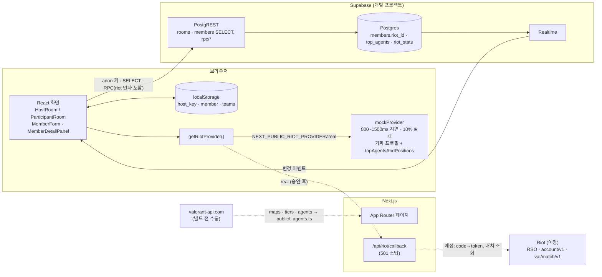
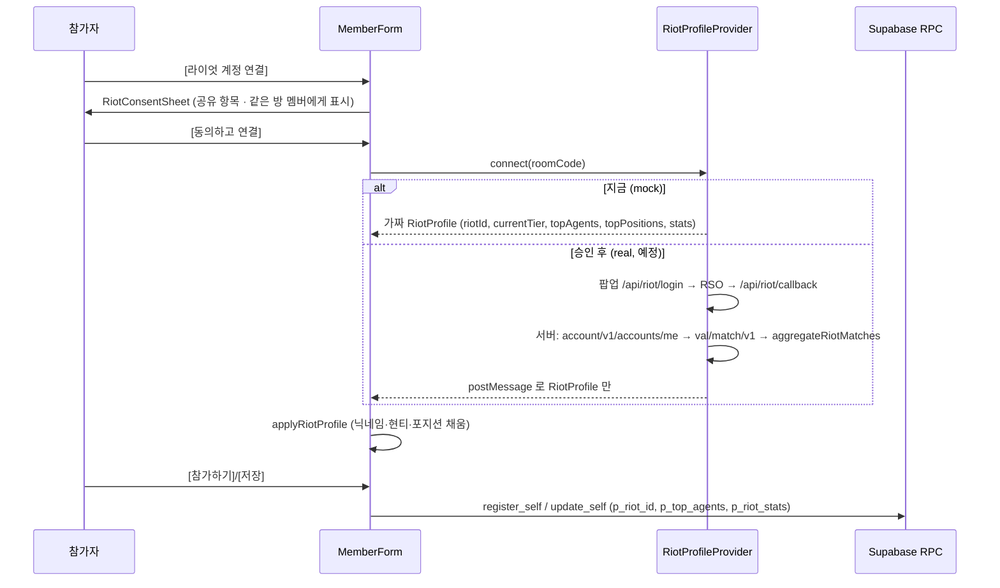

# 기술 스택 — 개발

> 환경: 개발(feature/riot-link) · 기준 커밋: `e28af42` · 작성일: 2026-10-08

이 브랜치는 운영 기능 전체(2026-10-08 `219e91b` 병합분)에 **라이엇 계정 연결**(가짜 데이터)과 **멤버 전적 · 상세 패널**을 더한 개발용 브랜치다.

## 1. 스택

버전은 `package.json` 기준.

| 영역 | 기술 | 버전 | 쓰는 이유 (근거) | 대안을 안 쓴 이유 |
|---|---|---|---|---|
| 프레임워크 | Next.js (App Router, Turbopack) | 16.3.8 | 페이지 + Route Handler(라이엇 RSO 콜백 자리) 한 프로젝트 (PRD §10) | 확인 필요 |
| UI | React / React DOM | 19.2.8 | Next.js 16 기본 | — |
| 언어 | TypeScript | ^5 | 전체 코드 | — |
| 스타일 | Tailwind CSS (`@tailwindcss/postcss`) | ^4 | DESIGN.md 토큰을 테마 변수로 | 확인 필요 |
| 서버 상태 | TanStack Query | ^5.104.1 | 방·멤버 조회 캐시, Realtime 이벤트 때 무효화 (PRD §8) | 확인 필요 |
| DB · 실시간 | Supabase (`@supabase/supabase-js`) | ^2.117.2 | Postgres + RLS + RPC + Realtime, anon 키만 (PRD §7) | 확인 필요 |
| DB CLI | `supabase` | ^2.119.0 | 마이그레이션 | — |
| 테스트 | Vitest | ^5.0.3 | 집계 · mock · 폼 자동 채우기 · RPC 검증 | 확인 필요 |
| 테스트 DB | PGlite (`@electric-sql/pglite`) | ^0.5.8 | 마이그레이션을 WASM Postgres 에 적용. Docker 없이 (`supabase/tests/rpc.test.ts`) | 로컬 Supabase(Docker) 미사용 |
| 컴포넌트 테스트 | Testing Library + jsdom | ^16.3.3 / ^30.1.2 | 방장·참가자 화면, 라이엇 버튼·전적 카드 | — |
| 린트 · 포맷 | ESLint, Prettier (+ tailwind 플러그인) | ^9 / ^3.9.9 | — | — |
| 라이엇 데이터 | provider 패턴: `mockProvider`(가짜) / `riotProvider`(자리만) | — | Production 키 승인 전 UI·DB 를 먼저 만들기 위해 (`src/features/riot/provider.ts`) | 실제 API 는 승인 후 |
| 정적 에셋 | valorant-api.com | — | 맵·티어·**요원** 이미지, 요원 표(`src/lib/constants/agents.ts`) 생성. 빌드 전 수동 (`scripts/fetch-assets.mts`) | 실행 중 외부 호출 없음 |

## 2. 환경변수

값은 쓰지 않는다. 이름은 `.env.example` 기준.

| 이름 | 용도 | 클라이언트 노출 | 설정 위치 |
|---|---|---|---|
| `NEXT_PUBLIC_SUPABASE_URL` | Supabase(개발 프로젝트) URL | O | 로컬 `.env.local` |
| `NEXT_PUBLIC_SUPABASE_ANON_KEY` | anon 키 | O | 로컬 |
| `NEXT_PUBLIC_RIOT_LINK_ENABLED` | `"true"` 일 때만 [라이엇 계정 연결] 표시. 기본 꺼짐. 빌드 때 값이 박힘 | O | 로컬 (Vercel 사용 여부 확인 필요) |
| `NEXT_PUBLIC_RIOT_PROVIDER` | `mock`(기본) / `real` | O | 로컬 |
| `RIOT_API_KEY` | VALORANT API 키 — **아직 미사용** | X (서버 전용) | 승인 후 |
| `RIOT_RSO_CLIENT_ID` | RSO OAuth — 미사용 | X | 승인 후 |
| `RIOT_RSO_CLIENT_SECRET` | RSO OAuth — 미사용 | X | 승인 후 |
| `RIOT_RSO_REDIRECT_URI` | RSO 콜백 URL — 미사용 | X | 승인 후 |

## 3. 아키텍처

### 라이엇 연결 흐름

## 4. 보안 설계

| 항목 | 설계 | 위치 |
|---|---|---|
| 비밀값 분리 | `host_key` → `room_secrets`, `edit_token` → `member_tokens`. RLS + 정책 없음 + `revoke all` | `supabase/migrations/20261006000000_rooms_members.sql` |
| 쓰기 경로 | 모든 쓰기는 `security definer` RPC, 권한 검사는 RPC 안 | 마이그레이션 전체 |
| 랜덤 | 맵·공수는 RPC 안 `random()`. (mock provider 의 랜덤은 표시용 데모 데이터) | `20261006010000_map_side_rpc.sql`, `src/features/riot/mockProvider.ts` |
| 방장 키 | `localStorage["host_key:{code}"]`. [방장 링크 복사] → `#key=` fragment (쿼리스트링 아님), 열면 저장 후 제거 | `src/features/room/useHostKey.ts` |
| edit_token | `localStorage["member:{code}"]`, 본인 수정·삭제 때만 | `src/features/members/meStorage.ts` |
| 라이엇 토큰 | API 키 · RSO 토큰은 서버에서만 쓰고 버린다 (설계). 지금은 호출 자체가 없음 | `src/features/riot/riotProvider.ts` 주석 |
| 라이엇 값 검증 | `_validate_riot`(Riot ID 형식, 요원 ≤3), `_validate_riot_stats`(키·범위·명중 합) → `INVALID_RIOT` | `20261007`~`20261010` 마이그레이션 |
| ⚠️ 위조 가능 | `riot_id` 를 클라이언트가 RPC 인자로 넘김 → "연결됨" 뱃지 위조 가능. 실제 연동 때 서버 검증 값만 저장해야 함 | PRD F3-11 |
| 정책 | 지표를 합친 점수·등급·순위(MMR/ELO 류) 없음. 팀 계산에 전적 미사용 | `src/features/riot/types.ts` 주석 |
| 기능 플래그 | `NEXT_PUBLIC_RIOT_LINK_ENABLED` 기본 꺼짐 — 운영에 미완성 기능 노출 방지 | `src/features/riot/config.ts` |
