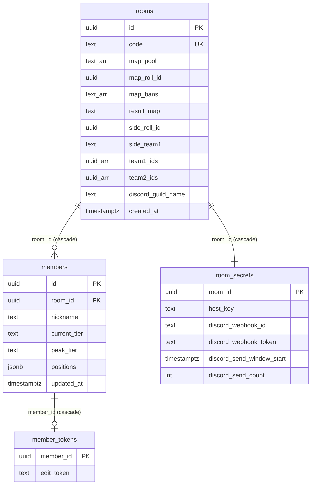

# API · 데이터 — 운영

> 환경: 운영(main) · 기준 커밋: `1333baa` · 작성일: 2026-10-08
> 근거: `supabase/migrations/*.sql`, `src/app/api/discord/*`, `src/features/*/api.ts`

## 1. DB 스키마

### 공개 테이블 (anon SELECT 허용, 직접 쓰기 불가)

**rooms**

| 컬럼 | 타입 | 제약 · 기본값 | 비고 |
|---|---|---|---|
| `id` | uuid | PK, `gen_random_uuid()` | |
| `code` | text | NOT NULL, UNIQUE | 6자리, 0/O/1/I/L 제외 |
| `map_pool` | text[] | NOT NULL, 기본 7개 맵 | |
| `map_roll_id` | uuid | null | 맵 랜덤마다 새 값 |
| `map_bans` | text[] | NOT NULL, `'{}'` | 마지막 맵 랜덤 때 밴 |
| `result_map` | text | null | |
| `side_roll_id` | uuid | null | |
| `side_team1` | text | `attack` / `defense` CHECK | |
| `created_at` | timestamptz | `now()` | 24시간 만료 기준 |
| `team1_ids` | uuid[] | null | 방장이 공유한 팀1 (F5-7) |
| `team2_ids` | uuid[] | null | 팀2 |
| `discord_guild_name` | text | null | 디스코드 연결 서버 이름. null=미연결, `''`=이름 모름 — **진행 중** |

**members**

| 컬럼 | 타입 | 제약 · 기본값 | 비고 |
|---|---|---|---|
| `id` | uuid | PK | |
| `room_id` | uuid | FK → rooms, on delete cascade, 인덱스 | |
| `nickname` | text | NOT NULL, 1~16자, UNIQUE(room_id, nickname) | |
| `current_tier` | text | null | 예 `gold_2`, `unranked`. null = 미입력 |
| `peak_tier` | text | null | |
| `positions` | jsonb | NOT NULL, 기본 4개 모두 `can` | `main` / `can` / `no` |
| `created_at` / `updated_at` | timestamptz | `now()` | |

### 비공개 테이블 (RLS 켜고 정책 없음 + `revoke all` → anon 접근 불가)

**room_secrets**

| 컬럼 | 타입 | 비고 |
|---|---|---|
| `room_id` | uuid PK, FK → rooms cascade | |
| `host_key` | text NOT NULL | 방장 키 |
| `discord_webhook_id` | text | 진행 중 |
| `discord_webhook_token` | text | 비밀값, 진행 중 |
| `discord_send_window_start` | timestamptz | 전송 제한 창 시작 |
| `discord_send_count` | int, 기본 0 | 창 안 전송 수 |

**member_tokens**: `member_id` uuid PK FK → members cascade, `edit_token` text NOT NULL.

### ERD

## 2. RPC (`POST {SUPABASE_URL}/rest/v1/rpc/{함수}`)

모두 `security definer`, `set search_path = public`. 실패는 `raise exception` 메시지 = 에러 코드.

| 이름 | 권한 | 파라미터 | 반환 | 에러 | 비고 |
|---|---|---|---|---|---|
| `create_room` | 누구나 | — | `{ code, host_key }` | `ROOM_CODE_EXHAUSTED` | 충돌 시 5회 재시도. 24시간 지난 방 삭제 |
| `verify_host_key` | 누구나 | `p_code, p_host_key` | void | `ROOM_NOT_FOUND`, `FORBIDDEN` | 방장 화면 진입 |
| `verify_host` | 누구나 | `p_code, p_host_key` | boolean | — | 디스코드 start 라우트. 없을 때만 생성 (진행 중) |
| `register_self` | 누구나 | `p_code, p_nickname, p_current_tier, p_peak_tier, p_positions` | `{ member_id, edit_token }` | `ROOM_NOT_FOUND`, `NICKNAME_TAKEN`, `INVALID_NICKNAME`, `INVALID_TIER`, `INVALID_POSITIONS` | 현티 필수 |
| `update_self` | 본인 (`edit_token`) | `p_member_id, p_edit_token, p_nickname, p_current_tier, p_peak_tier, p_positions` | void | `FORBIDDEN`, `NICKNAME_TAKEN`, `INVALID_*` | `updated_at` 갱신 |
| `delete_self` | 본인 | `p_member_id, p_edit_token` | void | `FORBIDDEN` | 토큰은 cascade 삭제 |
| `upsert_member_as_host` | 방장 | `p_code, p_host_key, p_member_id(null=추가), p_nickname, p_current_tier, p_peak_tier, p_positions` | member_id | `FORBIDDEN`, `MEMBER_NOT_FOUND`, `NICKNAME_TAKEN`, `INVALID_*` | 티어 미입력 허용 |
| `delete_member` | 방장 | `p_code, p_host_key, p_member_id` | void | `FORBIDDEN` | |
| `bulk_add_members` | 방장 | `p_code, p_host_key, p_nicknames[]` | 건너뛴 닉네임[] | `FORBIDDEN` | 화면에서 사용 안 함 |
| `set_map_pool` | 방장 | `p_code, p_host_key, p_maps[]` | void | `INVALID_MAP_POOL` | 1개 이상, 알려진 맵 키 |
| `roll_map` | 방장 | `p_code, p_host_key, p_bans[]` | `{ map, roll_id }` | `INVALID_BANS`, `NO_MAPS_LEFT` | 밴 0~2개, 풀 안, 중복 없음 |
| `roll_side` | 방장 | `p_code, p_host_key` | `attack` \| `defense` | `FORBIDDEN` | `random() < 0.5` |
| `set_teams` | 방장 | `p_code, p_host_key, p_team1 uuid[], p_team2 uuid[]` | void | `INVALID_TEAMS` | 각 5명, 중복 없음, 이 방 멤버 |
| `set_discord_webhook` | 방장 | `p_code, p_host_key, p_webhook_id, p_webhook_token, p_guild_name` | void | `INVALID_DISCORD` | 전송 횟수 초기화 (진행 중) |
| `clear_discord_webhook` | 방장 | `p_code, p_host_key` | `{ id, token }` | `FORBIDDEN` | 지우기 전 값 반환 (진행 중) |
| `get_discord_webhook_for_send` | 방장 | `p_code, p_host_key` | `{ id, token }` | `DISCORD_NOT_CONNECTED`, `DISCORD_RATE_LIMITED` | 1분 창 10회 (진행 중) |

내부 헬퍼(실행 권한 없음): `_new_secret`, `_raise`, `_is_tier`, `_validate_member`, `_host_room_id`, `_check_edit_token`, `_is_map_key`.

## 3. Route Handler (`src/app/api/discord/*`) — 진행 중

`NEXT_PUBLIC_DISCORD_ENABLED !== "true"` 이면 전부 `404 { error: "NOT_FOUND" }`.

| 메서드 | 경로 | 요청 | 응답 | 상태 코드 | 인증 |
|---|---|---|---|---|---|
| POST | `/api/discord/start` | `{ code, hostKey }` | `{ url }` + `Set-Cookie: discord_oauth` (httpOnly, secure, lax, 10분, path `/api/discord`) | 200, 400 `INVALID_BODY`, 403 `FORBIDDEN`, 502 `SERVER_ERROR`, 503 `DISCORD_NOT_CONFIGURED` | `verify_host` |
| GET | `/api/discord/callback` | `?code&state` 또는 `?error` + 쿠키 | `307` → `/room/{code}/host?discord=connected\|cancelled\|error`, 쿠키 삭제 | 307, 400 (쿠키 없음) | state 쿠키 비교 |
| POST | `/api/discord/send` | `{ code, hostKey, kind: teams\|map\|side\|all, teams? }` | `{ ok: true }` | 200, 400 `INVALID_BODY`/`INVALID_TEAMS`, 403, 404 `ROOM_NOT_FOUND`, 409 `DISCORD_NOT_CONNECTED`/`NOTHING_TO_SEND`, 410 `DISCORD_DISCONNECTED`, 429 `DISCORD_RATE_LIMITED`(+`retryAfter`), 502 | `get_discord_webhook_for_send` |
| POST | `/api/discord/disconnect` | `{ code, hostKey }` | `{ ok: true }` | 200, 400, 403, 404, 502 | `clear_discord_webhook` |

- `send` 의 `teams` 검증: 팀 2개, 각 1~5명, 닉네임 1~16자, `position` ∈ 4개 포지션·`flex`·null, `proficiency` ∈ `main`·`can`·`no`·null, 점수 0~1000.
- `send` 는 맵·공수를 DB(`rooms`)에서 직접 읽는다. `NOTHING_TO_SEND` 는 웹훅 조회(전송 횟수 1회 소모) 뒤에 판단한다.
- 웹훅 토큰은 어떤 응답에도 들어가지 않는다.

## 4. 에러 코드

| 코드 | 의미 | 발생 위치 | 프론트 문구 |
|---|---|---|---|
| `ROOM_NOT_FOUND` | 방 없음 | RPC, send | 홈: "방을 찾을 수 없어요. 코드를 다시 확인해주세요." / 참가자 등록: 방 다시 조회 → 만료 화면 |
| `FORBIDDEN` | 방장 키 · 토큰 불일치 | RPC, 라우트 | 방장: "방장 키가 맞지 않아요" / 참가자: "내 정보를 찾을 수 없어요. 다시 입력해주세요" |
| `NICKNAME_TAKEN` | 닉네임 중복 | RPC | 방장: "이미 있는 닉네임이에요" / 참가자: "이미 있는 닉네임이에요. 방장이 등록해뒀다면 방장에게 수정을 부탁하세요" |
| `MEMBER_NOT_FOUND` | 수정 대상 없음 | `upsert_member_as_host` | 공통: "저장하지 못했어요. 잠시 후 다시 시도해주세요" |
| `INVALID_NICKNAME` · `INVALID_TIER` · `INVALID_POSITIONS` | 입력 형식 | RPC | 공통 문구 (폼에서 먼저 막음) |
| `ROOM_CODE_EXHAUSTED` | 코드 생성 5회 충돌 | `create_room` | "방을 만들지 못했어요. 잠시 후 다시 시도해주세요." (방 만들기 실패 공통) |
| `INVALID_MAP_POOL` | 맵 풀 비었거나 모르는 맵 | `set_map_pool` | 공통 문구 |
| `INVALID_BANS` | 밴 규칙 위반 | `roll_map` | "밴은 맵 풀 안에서 2개까지만 고를 수 있어요" |
| `NO_MAPS_LEFT` | 남은 맵 0개 | `roll_map` | "남은 맵이 없어요" |
| `INVALID_TEAMS` | 팀 구성 오류 | `set_teams`, send | 팀 공유 실패: "참가자에게 팀을 공유하지 못했어요" (화면 진입 시 자동 공유는 무음) |
| `INVALID_DISCORD` | 웹훅 형식 | `set_discord_webhook` | callback → "디스코드에 연결하지 못했어요. 다시 시도해주세요" |
| `DISCORD_NOT_CONNECTED` | 연결 안 됨 | send | "디스코드가 연결돼 있지 않아요" |
| `DISCORD_RATE_LIMITED` | 1분 10회 초과 / 디스코드 429 | send | "디스코드 전송이 너무 잦아요. N초 뒤 다시 시도해주세요" |
| `DISCORD_DISCONNECTED` | 디스코드에서 웹훅 삭제(404/401) → 자동 해제 | send | "디스코드 채널의 웹훅이 삭제돼 연결이 해제됐어요. 다시 연결해주세요" |
| `DISCORD_NOT_CONFIGURED` | 서버 환경변수 없음 | start | "디스코드 연동 설정이 아직 안 돼 있어요" |
| `NOTHING_TO_SEND` | 보낼 결과 없음 | send | "보낼 결과가 없어요" |
| `UNKNOWN` · 네트워크 | 그 외 | — | 공통 문구 / "디스코드로 보내지 못했어요" |

## 5. Realtime

| 채널 | 테이블 | 이벤트 | 필터 |
|---|---|---|---|
| `room:{roomId}` | `members` | INSERT, UPDATE | `room_id=eq.{roomId}` |
| | `members` | DELETE | 없음 (캐시에 있는 id 만 반응, `replica identity full`) |
| | `rooms` | UPDATE | `id=eq.{roomId}` |

publication: `supabase_realtime` 에 `rooms`, `members` 만. 비공개 테이블은 없음.

## 6. 마이그레이션

| 파일 | 요약 | 운영 DB 적용 |
|---|---|---|
| `20261006000000_rooms_members.sql` | 테이블 4개 · RLS · 방/멤버/본인 RPC · Realtime | 확인 필요 (배포 사이트가 동작하면 적용된 상태) |
| `20261006010000_map_side_rpc.sql` | `set_map_pool`, `roll_map`, `roll_side` | 확인 필요 |
| `20261011000000_publish_teams.sql` | `rooms.team1_ids/team2_ids`, `set_teams` | 확인 필요 |
| `20261012000000_discord_webhook.sql` | 디스코드 컬럼 · `verify_host` · 웹훅 RPC 3개 (추가만, `if not exists`) | 확인 필요 (사용자가 SQL Editor 로 적용 예정) — 진행 중 |

## 7. 외부 API

| 대상 | 엔드포인트 | 용도 | 호출 위치 |
|---|---|---|---|
| Discord | `GET https://discord.com/oauth2/authorize?client_id&response_type=code&scope=webhook.incoming&redirect_uri&state` | 서버·채널 선택 | 브라우저 이동 (start 가 URL 생성) |
| Discord | `POST https://discord.com/api/oauth2/token` (form, `grant_type=authorization_code`) | code → 웹훅 `{ id, token }`, `guild.name`(없으면 null) | callback |
| Discord | `POST https://discord.com/api/webhooks/{id}/{token}?wait=true` | 임베드 전송 | send |
| Discord | `DELETE https://discord.com/api/webhooks/{id}/{token}` | 연결 해제 · 저장 실패 시 정리 (실패 무시) | disconnect, callback |
| valorant-api.com | `GET /v1/maps?language=ko-KR` | 맵 리스트·스플래시 이미지 → `public/maps/` | `scripts/fetch-assets.mts` (수동) |
| valorant-api.com | `GET /v1/competitivetiers?language=ko-KR` | 최신 시즌 티어 아이콘 → `public/tiers/` | 같음 |

임베드: username `naejeon-kit`, color `0xFF4655`, footer `naejeon-kit · 방 코드 {code}`, `allowed_mentions: { parse: [] }`. 팀(필드 2개 inline) · 맵(밴 포함) · 공수.
