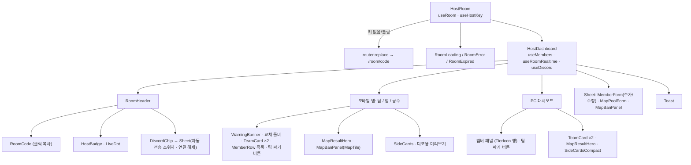
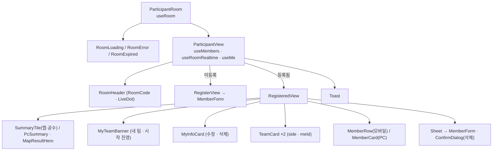

# 컴포넌트 — 운영

> 환경: 운영(main) · 기준 커밋: `1333baa` · 작성일: 2026-10-08

## 1. 라우트별 페이지

| 라우트 | 파일 | 렌더 | 설명 |
|---|---|---|---|
| `/` | `src/app/page.tsx` | `HomeScreen` | [방 파기] / 코드로 참가 |
| `/join/[code]` | `src/app/join/[code]/page.tsx` | `redirect` | `/room/{CODE}` 로 이동 (F2-7) |
| `/room/[code]` | `src/app/room/[code]/page.tsx` | `ParticipantRoom` | 참가자 화면 |
| `/room/[code]/host` | `src/app/room/[code]/host/page.tsx` | `HostRoom` | 방장 화면. 키 없으면 참가자 화면으로 (F2-8) |
| `/privacy` | `src/app/privacy/page.tsx` | `PrivacyPage` | 개인정보처리방침 (한/영) |
| `/api/discord/*` | `src/app/api/discord/*/route.ts` | Route Handler | [api.md](api.md) §3 |
| 공통 | `src/app/layout.tsx`, `src/app/providers.tsx` | `RootLayout`, `Providers` | 푸터(개인정보처리방침 링크·팬 제작 고지), QueryClient |

```
src/app
├─ layout.tsx ─ providers.tsx (QueryClientProvider)
├─ page.tsx ─ HomeScreen
├─ join/[code]/page.tsx (redirect)
├─ room/[code]/page.tsx ─ ParticipantRoom
├─ room/[code]/host/page.tsx ─ HostRoom
├─ privacy/page.tsx
└─ api/discord/{start,callback,send,disconnect}/route.ts
```

## 2. 컴포넌트 계층

### 방장 화면



### 참가자 화면



참가자 화면에는 디스코드 UI 가 없다.

## 3. 컴포넌트 표

| 이름 | 경로 | 역할 | 주요 props | 사용 훅·쿼리 |
|---|---|---|---|---|
| `HomeScreen` | `src/features/room/HomeScreen.tsx` | 방 만들기 · 코드 입력 참가 | — | `createRoom`, `fetchRoom`, `useRouter` |
| `HostRoom` | `src/features/room/HostRoom.tsx` | 방 조회 + 방장 키 확인 후 대시보드 | `code` | `useRoom`, `useHostKey` |
| `HostDashboard` | 같은 파일 | 방장 화면 전체 (멤버 CRUD · 팀 · 선수 교체 · 맵 · 공수 · 디스코드) | `room`, `host` | `useMembers`, `useRoomRealtime`, `useCopy`, `useDiscord` |
| `ParticipantRoom` | `src/features/room/ParticipantRoom.tsx` | 참가자 화면 진입 (내부 `ParticipantView`·`RegisterView`·`RegisteredView`·`MyTeamBanner`·`MyInfoCard`) | `code` | `useRoom`, `useMembers`, `useRoomRealtime`, `useMe` |
| `RoomHeader` | `src/features/room/RoomHeader.tsx` | 방 코드 · 방장 뱃지 · 실시간 점 · 오른쪽 액션 | `code`, `userType`, `connected`, `actions` | — |
| `RoomCode` | 같은 파일 | 코드 클릭 시 코드만 복사 | `code` | `useCopy` |
| `RoomLoading` / `RoomError` / `RoomExpired` | `src/features/room/RoomStatus.tsx` | 로딩 · 에러(다시 시도) · 만료 | `onRetry`(Error) | — |
| `TeamPairsSection` / `PairPicker` | `src/features/teams/TeamPairs.tsx` | 같은 팀 묶음 목록 · [+ 묶기] / 두 명 고르기 시트 | `pairs`, `members`, `onAdd`, `onRemove` / `members`, `pairs`, `onSubmit` | — |
| `TeamCard` | `src/features/teams/TeamCard.tsx` | 팀 카드. 교체 모드면 행이 버튼 | `team`, `index`, `swap?`, `side?`, `meId?` | — |
| `SideBadge` / `WarningBanner` | 같은 파일 | 시작 진영 배지 / 포지션 부족 경고 | `side` / `message` | — |
| `MemberForm` | `src/features/members/MemberForm.tsx` | 닉네임 · 현티/최티 · 포지션 입력 | `initial`, `submitLabel`, `error`, `onSubmit`, `onSubmitAndNext?`, `autoFocus?` | — |
| `MemberRow` / `MemberCard` / `TierText` | `src/features/members/MemberList.tsx` | 모바일 행 / PC 카드 / 티어 문구 | `member`, `isMe`, `highlight`, `trailing` | — |
| `TierIcon` | `src/features/members/TierIcon.tsx` | 티어 이미지 | `tier`, `size` | — |
| `MapBanPanel` | `src/features/map/MapBanPanel.tsx` | 밴 선택 · [맵 랜덤] | `pool`, `bans`, `rolled`, `rolling`, `onToggle`, `onRoll`, `onEditPool` | — |
| `MapTile` / `MapImage` | `src/features/map/MapCard.tsx` | 맵 카드 | `map`, `banned`, `picked`, `onClick` | — |
| `MapPoolForm` | `src/features/map/MapPoolForm.tsx` | 맵 풀 체크박스 | `initial`, `onSubmit` | — |
| `MapResultHero` | `src/features/map/MapResult.tsx` | 결과 맵 스플래시 | `map`, `label`, `className` | — |
| `SideCards` / `SideCardsCompact` | `src/features/side/SideCards.tsx` | 공수 결과 2칸 | `team1` | — |
| `DiscordChip` | `src/features/discord/DiscordControls.tsx` | [디스코드 연결] / "OO 서버 연결됨" + 시트 | `discord` (`useDiscord` 반환값) | — |
| `Button` / `IconButton` | `src/components/ui/Button.tsx` | 버튼 (variant · size) | `variant`, `size` | — |
| `Sheet` | `src/components/ui/Sheet.tsx` | 모바일 시트 / PC 모달 | `open`, `title`, `onClose`, `mobile` | — |
| `ConfirmDialog` | `src/components/ui/ConfirmDialog.tsx` | 확인 대화상자 | `open`, `title`, `onConfirm`, `onCancel`, `busy` | — |
| `Toast` | `src/components/ui/Toast.tsx` | 하단 토스트 | `message` | `useToast`, `useCopy` |

훅

| 훅 | 경로 | 역할 |
|---|---|---|
| `useRoom` / `useMembers` | `src/features/room/queries.ts` | 방 · 멤버 조회 |
| `useRoomRealtime` | 같은 파일 | Realtime 구독 → 쿼리 무효화, 연결 여부 반환 |
| `useHostKey` | `src/features/room/useHostKey.ts` | `#key=` 처리 + 저장된 키 검증 |
| `useMe` | `src/features/members/useMe.ts` | 참가자 본인 `{ id, token }` |
| `useDiscord` | `src/features/discord/useDiscord.ts` | 연결 상태 · 자동 전송 · `?discord=` 결과 토스트 |
| `useToast` / `useCopy` | `src/components/ui/Toast.tsx` | 토스트 · 클립보드 복사 |

## 4. features 폴더 책임

| 폴더 | 책임 |
|---|---|
| `features/room` | 방 생성·조회 API, 쿼리·Realtime, 방장 키, 방장/참가자 화면 |
| `features/members` | 멤버 API(RPC), 폼, 목록, 티어·포지션 표시, 본인 토큰 저장 |
| `features/teams` | 팀 생성 알고리즘, 점수, 선수 교체, 상위 조합 순환, 팀 공유(id ↔ 결과), 팀 카드 |
| `features/map` | 맵 풀 · 밴 · 결과 표시 |
| `features/side` | 공수 라벨 · 카드 |
| `features/share` | 디코용 복사 텍스트 |
| `features/discord` | 임베드 빌더, 전송 데이터 검증, 서버 전용 DB·Discord 호출(`server/`), 클라이언트 API·훅·칩 — **진행 중** |
| `lib/constants` | 티어 점수, 포지션, 맵, 방 상수, `storageKeys` |
| `lib/supabase` | 브라우저 클라이언트, 서버 클라이언트, RPC 에러 코드 |

## 5. 상태 관리

### TanStack Query

| 키 | 조회 | 옵션 |
|---|---|---|
| `["room", code]` | `fetchRoom` — `rooms` SELECT, 24시간 지난 방은 null | 기본: `staleTime 30s`, `refetchOnReconnect`, `refetchOnWindowFocus` (`src/app/providers.tsx`) |
| `["members", roomId]` | `fetchMembers` — `members` SELECT, `created_at` 순 | 같음 |
| `["host-key", code]` | `useHostKey` | `staleTime: Infinity`, `retry: false` |

### Realtime (`src/features/room/queries.ts`, 채널 `room:{roomId}`)

| 테이블 | 이벤트 | 필터 | 처리 |
|---|---|---|---|
| `members` | INSERT, UPDATE | `room_id=eq.{id}` | 멤버 다시 조회 |
| `members` | DELETE | 없음 | 지워진 id 가 캐시에 있을 때만 다시 조회 |
| `rooms` | UPDATE | `id=eq.{id}` | 방 다시 조회 (맵 · 공수 · 팀 구성 · 디스코드 서버 이름) |

`SUBSCRIBED` 직후 한 번 더 조회한다.

### localStorage (`src/lib/constants/room.ts` `storageKeys`)

| 키 | 값 | 용도 |
|---|---|---|
| `host_key:{code}` | 방장 키 | 방장 권한 증명 |
| `member:{code}` | `{ id, token }` | 참가자 본인 수정·삭제 |
| `teams:{code}` | `{ key, options[10], index }` | 팀 결과 유지 · [팀 다시 짜기] 순환 |
| `team_pairs:{code}` | `[[id, id], …]` 최대 4쌍 | 같은 팀 묶음 (F5-8) |
| `discord_auto:{code}` | `"on"` / `"off"` (없으면 켬) | 디스코드 자동 전송 |

모든 접근은 `src/lib/storage.ts` 의 try/catch 래퍼.

## 6. 반응형 (`lg` = 64rem)

| 화면 | 모바일 | PC |
|---|---|---|
| 방장 | 상단 [참가 링크 복사], 탭(팀/맵/공수), 하단 고정 [팀 짜기] | 왼쪽 멤버 패널(360px) + 오른쪽 팀 카드 2열 · 맵 · 공수 카드, 헤더에 링크 복사 · 새로고침 · 디코용 복사 |
| 방장 헤더 | 방 코드 · 방장 뱃지 · 디스코드 칩 · 새로고침 | 로고 · 방 코드 · 뱃지 · 실시간 점 · 디스코드 칩 · 버튼들 |
| 참가자 | 맵·공수 타일 → 내 팀 → 내 정보 → 팀 → 멤버 목록 | 왼쪽(400px) 내 팀 · 내 정보, 오른쪽 맵 · 공수 · 팀 2열 · 멤버 카드 그리드 |
| 시트 | 하단 시트 / 전체 화면 | 모달 |
