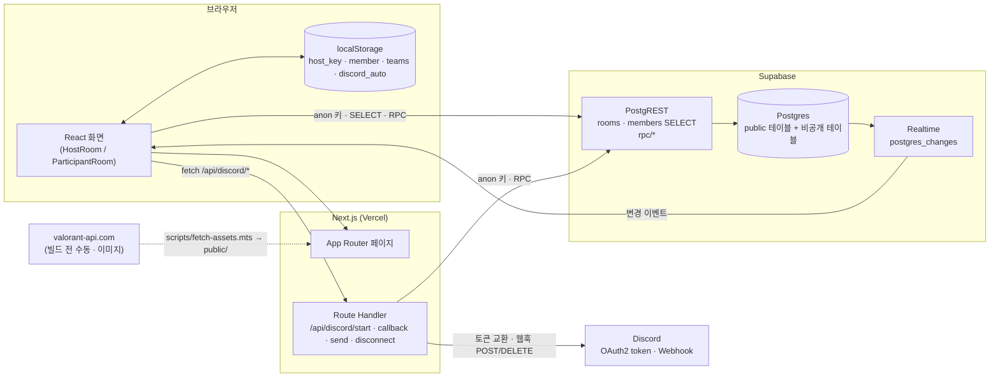

# 기술 스택 — 운영

> 환경: 운영(main) · 기준 커밋: `1333baa` · 작성일: 2026-10-08

## 1. 스택

버전은 `package.json` 기준 (`^` 는 범위 지정).

| 영역 | 기술 | 버전 | 쓰는 이유 (근거) | 대안을 안 쓴 이유 |
|---|---|---|---|---|
| 프레임워크 | Next.js (App Router, Turbopack) | 16.3.8 | 페이지 + 서버 Route Handler(디스코드 OAuth·전송)를 한 프로젝트에서. Vercel 배포 (PRD §10) | 확인 필요 |
| UI | React / React DOM | 19.2.8 | Next.js 16 기본 | — |
| 언어 | TypeScript | ^5 | 전체 코드 | — |
| 스타일 | Tailwind CSS (`@tailwindcss/postcss`) | ^4 | 디자인 토큰을 `globals.css` 테마 변수로 (DESIGN.md §3) | 확인 필요 |
| 서버 상태 | TanStack Query | ^5.104.1 | 방·멤버 조회 캐시, Realtime 이벤트 때 `invalidateQueries` (PRD §8) | 확인 필요 |
| DB · 실시간 | Supabase (`@supabase/supabase-js`) | ^2.117.2 | Postgres + RLS + RPC + Realtime, 로그인 없이 anon 키 (PRD §7) | 확인 필요 |
| DB CLI | `supabase` | ^2.119.0 | 마이그레이션 관리 | — |
| 테스트 | Vitest | ^5.0.3 | 순수 로직 · 컴포넌트 · RPC 테스트 (`vitest.config.mts`) | 확인 필요 |
| 테스트 DB | PGlite (`@electric-sql/pglite`) | ^0.5.8 | 마이그레이션을 WASM Postgres 에 적용해 RPC 권한 검증. **Docker 없이** (`supabase/tests/rpc.test.ts` 주석) | 로컬 Supabase(Docker) 미사용 |
| 컴포넌트 테스트 | Testing Library + jsdom | ^16.3.3 / ^30.1.2 | 방장 화면 테스트 (`HostRoom.test.tsx`) | — |
| 린트 · 포맷 | ESLint (`eslint-config-next`), Prettier (+ tailwind 플러그인) | ^9 / ^3.9.9 | `npm run lint`, `npm run format` | — |
| 배포 | Vercel | — | PRD §10, 개인정보처리방침 처리 위탁 | — |
| 외부 이미지 | valorant-api.com | — | 맵·티어 이미지를 빌드 전 수동으로 받아 `public/` 에 저장 (`scripts/fetch-assets.mts`) | 실행 중 외부 호출 없음 |
| 외부 연동 | Discord OAuth2 · Webhook | — | 결과 자동 전송. 봇 없이 `webhook.incoming` (PRD F10) — **진행 중** | 봇 방식은 쓰지 않기로 결정 |

## 2. 환경변수

값은 이 문서에 쓰지 않는다. 이름은 `.env.example` 기준.

| 이름 | 용도 | 클라이언트 노출 | 설정 위치 |
|---|---|---|---|
| `NEXT_PUBLIC_SUPABASE_URL` | Supabase 프로젝트 URL | O (`NEXT_PUBLIC_`) | 로컬 `.env.local`, Vercel |
| `NEXT_PUBLIC_SUPABASE_ANON_KEY` | anon 키 (모든 쓰기는 RPC 가 권한 검사) | O | 로컬, Vercel |
| `NEXT_PUBLIC_DISCORD_ENABLED` | `"true"` 일 때만 디스코드 UI · `/api/discord/*` 활성 (아니면 404). 빌드 때 값이 박힘 | O | 로컬, Vercel |
| `DISCORD_CLIENT_ID` | Discord OAuth2 앱 ID | X (서버 전용) | 로컬, Vercel |
| `DISCORD_CLIENT_SECRET` | Discord OAuth2 시크릿 | X | 로컬, Vercel |
| `DISCORD_REDIRECT_URI` | `https://<도메인>/api/discord/callback`. Developer Portal Redirects 와 같아야 함 | X | 로컬, Vercel |

## 3. 아키텍처

## 4. 보안 설계

| 항목 | 설계 | 위치 |
|---|---|---|
| 비밀값 분리 | `host_key` → `room_secrets`, `edit_token` → `member_tokens`, 디스코드 웹훅 id/token → `room_secrets`. RLS 켜고 정책 없음 + `revoke all` → anon SELECT 불가 | `supabase/migrations/20261006000000_rooms_members.sql`, `20261012000000_discord_webhook.sql` |
| 쓰기 경로 | 모든 쓰기는 `security definer` + `set search_path = public` RPC. 권한 검사는 RPC 안 (`_host_room_id`, `_check_edit_token`) | 마이그레이션 전체 |
| 실행 권한 | `revoke execute on all functions ... from public, anon, authenticated` 후 공개 RPC 만 `grant` | 같은 파일 |
| 랜덤 | 맵·공수는 RPC 안 `random()` 만. 클라이언트 랜덤 없음 | `20261006010000_map_side_rpc.sql` |
| 방장 키 | 방 생성 시 1회 발급 → `localStorage["host_key:{code}"]`. `#key=` fragment 로 열면 저장 후 URL 에서 제거 (쿼리스트링 아님). 화면의 [방장 링크 복사] 버튼은 제거됨 | `src/features/room/useHostKey.ts` |
| edit_token | 참가자 등록 시 1회 발급 → `localStorage["member:{code}"]`. 본인 수정·삭제 때만 RPC 인자로 | `src/features/members/meStorage.ts` |
| 디스코드 웹훅 | 토큰은 서버 Route Handler 안에서만 사용, 응답에 싣지 않음. OAuth state 는 httpOnly·secure·sameSite=lax 쿠키 10분, 상수 시간 비교. 액세스 토큰 저장 안 함 | `src/features/discord/server/*`, `src/app/api/discord/*` |
| 디스코드 메시지 | 닉네임 마크다운 이스케이프 + `@` 뒤 zero-width space, `allowed_mentions: { parse: [] }` | `src/features/discord/embed.ts` |
| 전송 제한 | 방마다 1분 창 10회 (`get_discord_webhook_for_send`) | `20261012000000_discord_webhook.sql` |
| ⚠️ 알려진 한계 | 디스코드 RPC 가 anon 에게 열려 있어, 방장 키를 가진 사람은 RPC 를 직접 호출해 웹훅 토큰을 받을 수 있다 | PRD §7.3 주석 |
| 만료 | `create_room()` 실행 시 24시간 지난 방 삭제 (cascade 로 비밀 테이블도). `pg_cron` 사용 여부는 확인 필요 | `20261006000000_rooms_members.sql` |
